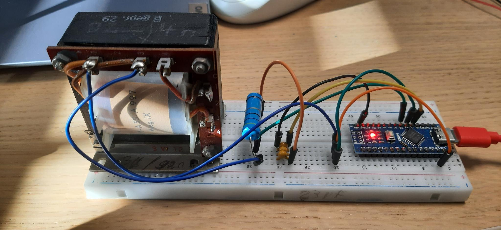

# Nichtlineares RLC-Glied: Sprungantwort mit dem Arduino Nano messen und auswerten

Prof. Dr.-Ing. Ralph Wystup M.Sc. — erstellt mit KI und Agent (Claude Code, Anthropic)

**Seite öffnen:** https://ralphwystup.github.io/Nichtlineares-RLC-Glied-Sprungantwort-mit-Arduino-Nano-messen-und-auswerten/ — eine einzige HTML-Datei: Sprung auslösen und aufzeichnen (Web Serial, Chrome oder Edge),
Sprungantwort und den **Mittelwert der PWM-Anregung** zeichnen, Kennwerte nach dem logarithmischen Dekrement, Messdateien
laden und vergleichen, ein Prüfreiter mit Zoom bis auf den einzelnen Abtastwert, Fotos des Aufbaus, Schaltplan und die
Theorie aus dem Manuskript und von der Theorieseite zum Verfahren_HR (L(i) und C(u) als Kennlinien, tanh-Netze nach dem Verfahren_HR), der über den Messwiderstand gemessene Strom gegen C·dU_C/dt, ein Reiter „Impulsantwort“ (aus der Sprungantwort: ableiten, integrieren, vergleichen, bis der Rest unter einer ADC-Stufe liegt), Strommessung über einen Messwiderstand zwischen Spule und Kondensator (Firmware 2.7, A2). Ohne Nano läuft die Seite mit drei eingebetteten Messungen.

**Reiter „Verfahren_HR“ – das Verfahren Schritt für Schritt:** [`RLC_Sprung_2.26.html#hr`](RLC_Sprung_2.26.html#hr) (https://ralphwystup.github.io/Nichtlineares-RLC-Glied-Sprungantwort-mit-Arduino-Nano-messen-und-auswerten/RLC_Sprung_2.26.html#hr) führt an der gemessenen Sprungantwort vor, wie aus
Spannungen und Strom die Kennlinien ψ(i) und q(uC) extrahiert werden (RCu aus ψ(∞) = 0, Fluss und Ladung durch Integration,
Eisenverlust RFe aus der Schleife der ψ(i)-Punktwolke), wie beide Kennlinien als tanh-Summen angefittet werden (jede Reihe als Gleichung
mit Koeffiziententafel, gegen ein Polynom gleicher Parameterzahl), wie daraus Ld(i) und Cd(uC) folgen und wie die
nichtlineare DGL damit die Sprungantwort nachbildet (T = 140: 2 % der Sprunghöhe) und andere Anregungen ohne Anpassung vorhersagt.
Dazu der direkte Fit der Sprungantwort und die Impulsantwort als Ableitung der Summe, ein Vergleich, wie viele Glieder welcher Weg braucht,
„Simulation und Suche“ (Schritt 11: die Kennlinienparameter und RFe mit Levenberg-Marquardt gegen die Messungen nachgestellt – vorgegeben über
**alle vier Messungen gemeinsam** (T = 60, 100, 128, 140), ein Parametersatz mit 1,1 … 1,5 % ΔU auf allen vier; aus einer Messung allein trägt das Modell nicht
über die Amplitude (T = 60 dann 12 %); Kennlinien monoton erzwungen, RCu festgehalten, Fehler nach der Hüllkurve gewichtet, damit die späteren Maxima zählen)
und „Faltung gegen DGL“ (Schritt 12: die Impulsantwort der einen Messung als FIR mit der Anregung der anderen gefaltet – gilt nur linear: bei den nahen Anregungen
T = 128/140 trifft die Faltung auf 0,6 %, bei T = 60 aus T = 140 auf 5,4 % mit 8 % zu hohem Scheitel, die gemeinsam nachgestellte DGL auf 1,1 %).
Befund der Messreihe: Der Überschwingfaktor steigt mit der Anregung (1,48 / 1,53 / 1,57 / 1,60 für T = 60 / 100 / 128 / 140), die Dämpfung nimmt bei kleiner
Amplitude also zu; eine Koerzitivspannung als Hysterese-Glied erklärt das nicht (läuft in der Suche gegen null).

**Physikalisches Modell (2.26, Schritt 13):** Die halbe Schwingungsdauer fällt in jeder Aufzeichnung von 53 ms auf 32 ms, am Umkehrpunkt des Stroms ist
die Induktivität klein (3–5 H) und wächst mit dem Abstand vom Umkehrpunkt (etwa 4 H je mA) – das Rayleigh-Gesetz der Eisenhysterese. Ein Preisach-Modell
mit exponentieller Hysteronendichte über der Koerzitivität (Lrev, ρ0, hc), C(uC) = C0/(1+γu²) und
ein Reihenwiderstand – sechs physikalische Zahlen, ein Satz für alle Messungen – trifft T60 … T140 auf 0,8 % ΔU (Vorrechnung, ohne Gewichtung; auf der Seite mit
Hüllkurven-Gewichtung 1,2 %), die Hysterese liefert Induktivität und Verlust zugleich. Was bleibt: im Ausklang ist die gemessene Dämpfung um 15 % höher als im
Modell (ζ 0,22 statt 0,20), ein fester Eisenverlust RFe würde die erste Schwingung überdämpfen. **Wiederholbarkeit (Schritt 14):** zwei Aufzeichnungen
T140 vom 23. und 24.11. unterscheiden sich um 0,47 % ΔU (49 mV im Anstieg bei gleichem Scheitel) – die Untergrenze für jedes gemeinsame Modell; der direkte Fit
einer einzelnen Aufzeichnung (0,1 %) passt deren Eigenheiten mit. Der DGL-Fitter wurde geprüft (Schrittweite: 4 Unterschritte je ms kosteten bis 5 mV, jetzt 10;
synthetische Antworten werden auf Rauschhöhe wiedergefunden, die Parameter sind nur mit dem Stromkanal eindeutig).

Ein Arduino Nano legt mit Pin 11 (Timer2, 31,4 kHz) einen PWM-Sprung an einen Serienschwingkreis aus einer Drossel
mit Eisenkern (92 Ω ist der Kupferwiderstand ihrer Wicklung) und einem Kondensator. A0 misst die Kondensatorspannung UC, A1 die Pinspannung; beide werden
von Timer1 alle 125 µs abwechselnd gewandelt. Auf A1 werden High- und Low-Treffer getrennt summiert, so dass das
Eingangssignal der Strecke exakt bekannt ist: UE = d·UH + (1 − d)·UL mit den Pegeln
unter Last. Die Nennwerte (92 Ω, 3,9 H, 23 µF) beschreiben die Messung nicht; der Eisenkern macht die Induktivität
vom Strom abhängig, der Überschwingfaktor steigt mit der Anregung (1,54 bei T = 128, 1,63 bei T = 140).

**Schutz des ADC-Eingangs:** Der Tastgrad ist im Nano und in der Seite auf T ≤ 140 begrenzt (Scheitel ≤ 4,5 V, Datenblatt
ATmega328P: 0 … VCC), und nach jeder Messung fährt die Anregung als Rampe auf 0, damit UC nie
negativ wird. Das Datenblatt (Microchip, 7810D–AVR–01/15) liegt nicht bei: https://www.microchip.com/en-us/product/ATmega328P

**Manuskript:** [`rlc_manuskript_2.1_mit_Schaltplan.pdf`](rlc_manuskript_2.1_mit_Schaltplan.pdf) — Vorlesungsmanuskript „Nichtlineare Modellierung der Sprungantwort eines
RLC-Schwingkreises“ (04.03.2026), Fassung 2.1 mit dem Schaltplan, Text unverändert (Abschnitt 3.1 und 8 rechnen dort noch mit einem äußeren Widerstand, den es nicht gibt).

## Was drin ist

| Datei | Inhalt |
|:--|:--|
| [`RLC_Sprung_2.26.html`](RLC_Sprung_2.26.html) | die Seite (All-in-one): Messen über Web Serial, Auswertung, Prüfreiter mit Zoom, Aufbau und Theorie, Stromansicht (Shunt), Reiter „Verfahren_HR“ (Kennlinienweg in zwölf Schritten mit Suche und Faltung, Schritt 13 physikalisches Hysteresemodell der Drossel nach Preisach/Rayleigh mit sechs Parametern für alle Messungen, Schritt 14 Wiederholbarkeit zweier Aufzeichnungen), Reiter „Impulsantwort“, Reiter „Anfitten“ (tanh-Netz nach dem Verfahren_HR gegen Fourier und Potenzreihe bei gleicher Parameterzahl, K steigern bis 0,1 % der Sprunghöhe, Fortsetzungstest) |
| [`rlc_manuskript_2.1_mit_Schaltplan.pdf`](rlc_manuskript_2.1_mit_Schaltplan.pdf) / [`.docx`](rlc_manuskript_2.1_mit_Schaltplan.docx) / [`.md`](rlc_manuskript_2.1_mit_Schaltplan.md) | das Manuskript |
| `nano/` | `rlc_sprung_2_6.ino` (Firmware ohne Shunt) und `rlc_sprung_2_7.ino` (mit A2 = Spulenende, Strom über R_s = 47 Ω zwischen Spule und Kondensator), Befehl `M T N V F B P R`, 1 000 000 Bd; `rlc_bauen_laden_2.6/2.7.py` (arduino-cli, Board `arduino:avr:nano:cpu=atmega328old`), `rlc_messen_2.6/2.7.py` (Messen ohne Browser), `arduino_cli_laden_1.2.py` (arduino-cli portabel holen) |
| `messungen/` | Messdateien mit Shunt 47 Ω (rlc27; 23.11.2026 T = 60, 100, 128, 140; 24.11.2026 T = 20, 30, 40, 50, 140 -- die zweite T140 für die Wiederholbarkeit; Spalten … U_C_V U_2_V U_H_V U_L_V U_E_V i_mA), 22.11.2026 ohne Shunt (rlc25/26) und die alte Simulink-Messung vom 03.03.2026 |
| `seite/` | Vorlagen und Erzeuger beider Seiten, Knopfproben (kopfloser Chromium über CDP, Skalierung 1 und 1,5) mit Prüfausgaben, Schaltplan als SVG, `formeln_klammern_1.0.py` (MathML-Klammern), `seite_frage_1.0.mjs` (Nachmessen im Browser) |
| `verfahren_hr/` | Vorrechnung in Python (NumPy/SciPy/numba): Kennlinienweg (Kennlinien, R_Fe-Abtastung, DGL, Suche, Faltung) und das physikalische Modell (Extrema und Äste, modellfreies L_d, Rayleigh 1.0, Preisach 1.1 … 1.9 mit Produkt-/Exponential-/Gamma-Dichte, Debye-Zweig, linearen Verlusten, idealer Anregung; Bauteilprüfung, direkter Drosselfit, Prüfung des DGL-Fitters) |
| `bilder/` | Fotos des Aufbaus, Schaltplan (SVG, PNG) |
| `index.html` | leitet auf die Seite weiter, damit GitHub Pages sie unter der Adresse oben zeigt |
| `RLC_Sprung_2.23/2.24/2.25.html`, `Verfahren_HR_1.0/1.1.html` | Wegweiser früherer Fassungen und der früheren Einzelseite auf die aktuelle Seite (gemerkte Verweise bleiben gültig) |

## Messen

1. `nano/rlc_sprung_2_6.ino` auf den Nano laden (`python3 nano/rlc_bauen_laden_2.6.py`, arduino-cli vorher mit `arduino_cli_laden_1.2.py` holen; Anschluss im Skript, Vorgabe COM5).
2. `RLC_Sprung_2.26.html` in Chrome oder Edge öffnen, „Verbinden …“, Anschluss wählen, Tastgrad T (0 … 140), „Sprung messen“. Jede Messung wird im gewählten Ordner unter `Messungen_TT.MM.JJJJ` abgelegt.
3. Ohne Browser: `python3 nano/rlc_messen_2.6.py T:N:V:F:B:P[:R]`, z. B. `128:600:3000:3:4:20:2000`.

## Prüfen

    cd seite && node rlc_seite_probe_1.27.mjs <cdp-port> <pfad>/RLC_Sprung_2.26.html <ausgabeordner> 1.5

Die Knopfprobe drückt im kopflosen Chromium jeden Knopf (Reiter, Zoom per Rad und Rahmen, Löschknöpfe zweistufig, Laden,
Kennwerte gegen eigene Rechnung aus der Messdatei, Klammern der Formeln im Bild gemessen): 46 + 29 Prüfungen richtig bei Skalierung 1 und 1,5, Dateiprobe 4 von 4
(`seite/pruefung/`). Nur „Verbinden“ (Web Serial) kann kopflos nicht gedrückt werden.

Für den Reiter Verfahren_HR rechnet dieselbe Probe alle Schritte samt Suche und Faltung, prüft die Zahlen gegen die Python-Vorrechnung (R_Cu, R_Fe, C, Fit-Reste,
DGL-Fehler an beiden Messungen), klickt jeden Schritt an und misst Leinwände, Tafeln, Gleichungen und Klammern (Prüfungen H1 … H24; H23 physikalisches Modell, H24 Wiederholbarkeit).

## Lizenz

MIT, siehe [LICENSE](LICENSE).
