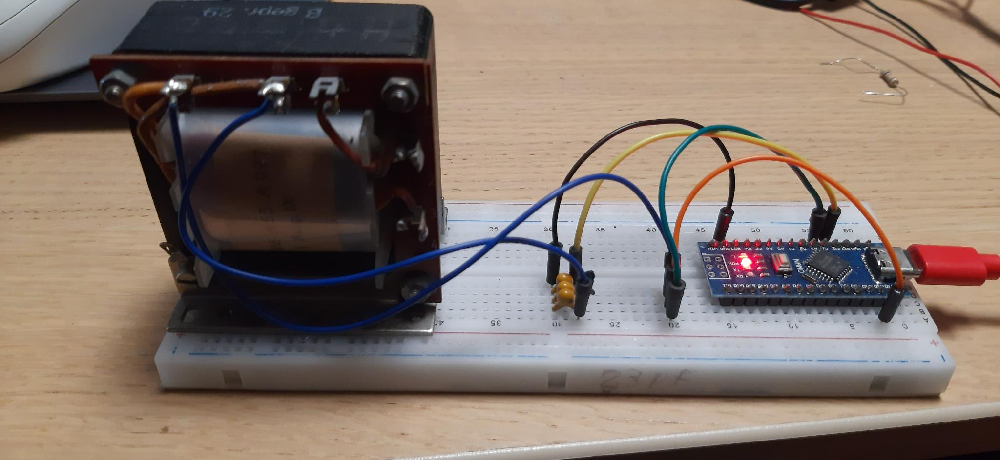

# Nichtlineares RLC-Glied: Sprungantwort mit dem Arduino Nano messen und auswerten

Prof. Dr.-Ing. Ralph Wystup M.Sc. — erstellt mit KI und Agent (Claude Code, Anthropic)

**Seite öffnen:** https://ralphwystup.github.io/Nichtlineares-RLC-Glied-Sprungantwort-mit-Arduino-Nano-messen-und-auswerten/ — eine einzige HTML-Datei: Sprung auslösen und aufzeichnen (Web Serial, Chrome oder Edge),
Sprungantwort und den **Mittelwert der PWM-Anregung** zeichnen, Kennwerte nach dem logarithmischen Dekrement, Messdateien
laden und vergleichen, ein Prüfreiter mit Zoom bis auf den einzelnen Abtastwert, Fotos des Aufbaus, Schaltplan und die
Theorie aus dem Manuskript und von der Ruppert-Theorieseite (L(i) und C(u) als Kennlinien, tanh-Netze nach Ruppert), ein Kalibrierreiter für den Innenwiderstand der Port-Treiber (Messwiderstand) und daraus der Strom aus dem Port-Abfall. Ohne Nano läuft die Seite mit drei eingebetteten Messungen.

Ein Arduino Nano legt mit Pin 11 (Timer2, 31,4 kHz) einen PWM-Sprung an einen Serienschwingkreis aus einer Drossel
mit Eisenkern (92 Ω ist der Kupferwiderstand ihrer Wicklung) und einem Kondensator. A0 misst die Kondensatorspannung UC, A1 die Pinspannung; beide werden
von Timer1 alle 125 µs abwechselnd gewandelt. Auf A1 werden High- und Low-Treffer getrennt summiert, so dass das
Eingangssignal der Strecke exakt bekannt ist: UE = d·UH + (1 − d)·UL mit den Pegeln
unter Last. Die Nennwerte (92 Ω, 3,9 H, 23 µF) beschreiben die Messung nicht; der Eisenkern macht die Induktivität
vom Strom abhängig, der Überschwingfaktor steigt mit der Anregung (1,54 bei T = 128, 1,63 bei T = 140).

**Schutz des ADC-Eingangs:** Der Tastgrad ist im Nano und in der Seite auf T ≤ 140 begrenzt (Scheitel ≤ 4,5 V, Datenblatt
ATmega328P: 0 … VCC), und nach jeder Messung fährt die Anregung als Rampe auf 0, damit UC nie
negativ wird. Das Datenblatt (Microchip, 7810D–AVR–01/15) liegt nicht bei: https://www.microchip.com/en-us/product/ATmega328P

**Manuskript:** [`rlc_manuskript_2.1_mit_Schaltplan.pdf`](rlc_manuskript_2.1_mit_Schaltplan.pdf) — Vorlesungsmanuskript „Nichtlineare Modellierung der Sprungantwort eines
RLC-Schwingkreises“ (04.03.2026), Fassung 2.1 mit dem Schaltplan, Text unverändert (Abschnitt 3.1 und 8 rechnen dort noch mit einem äußeren Widerstand, den es nicht gibt).

## Was drin ist

| Datei | Inhalt |
|:--|:--|
| [`RLC_Sprung_2.11.html`](RLC_Sprung_2.11.html) | die Seite (All-in-one): Messen über Web Serial, Auswertung, Prüfreiter mit Zoom, Aufbau und Theorie, Reiter „Kalibrieren“ (Port-Innenwiderstand, Strom aus dem Port-Abfall), Reiter „Anfitten“ vorbereitet |
| [`rlc_manuskript_2.1_mit_Schaltplan.pdf`](rlc_manuskript_2.1_mit_Schaltplan.pdf) / [`.docx`](rlc_manuskript_2.1_mit_Schaltplan.docx) / [`.md`](rlc_manuskript_2.1_mit_Schaltplan.md) | das Manuskript |
| `nano/` | `rlc_sprung_2_6.ino` (Firmware, Befehl `M T N V F B P R`, 1 000 000 Bd), `rlc_bauen_laden_2.6.py` (arduino-cli, Board `arduino:avr:nano:cpu=atmega328old`), `rlc_messen_2.6.py` (Messen ohne Browser), `arduino_cli_laden_1.2.py` (arduino-cli portabel holen) |
| `messungen/` | Messdateien 22.11.2026 (T = 128 und 140, Spalten k t_s s0 sH nH sL nL nF U_C_V U_H_V U_L_V U_E_V) und die Simulink-Messung vom 03.03.2026 |
| `seite/` | Vorlage und Erzeuger der Seite, Knopfprobe (kopfloser Chromium über CDP, Skalierung 1 und 1,5) mit Prüfausgaben, Schaltplan als SVG |
| `bilder/` | Fotos des Aufbaus, Schaltplan (SVG, PNG) |
| `index.html` | leitet auf die Seite weiter, damit GitHub Pages sie unter der Adresse oben zeigt |

## Messen

1. `nano/rlc_sprung_2_6.ino` auf den Nano laden (`python3 nano/rlc_bauen_laden_2.6.py`, arduino-cli vorher mit `arduino_cli_laden_1.2.py` holen; Anschluss im Skript, Vorgabe COM5).
2. `RLC_Sprung_2.11.html` in Chrome oder Edge öffnen, „Verbinden …“, Anschluss wählen, Tastgrad T (0 … 140), „Sprung messen“. Jede Messung wird im gewählten Ordner unter `Messungen_TT.MM.JJJJ` abgelegt.
3. Ohne Browser: `python3 nano/rlc_messen_2.6.py T:N:V:F:B:P[:R]`, z. B. `128:600:3000:3:4:20:2000`.

## Prüfen

    cd seite && node rlc_seite_probe_1.12.mjs <cdp-port> <pfad>/RLC_Sprung_2.11.html <ausgabeordner> 1.5

Die Knopfprobe drückt im kopflosen Chromium jeden Knopf (Reiter, Zoom per Rad und Rahmen, Löschknöpfe zweistufig, Laden,
Kennwerte gegen eigene Rechnung aus der Messdatei): 44 von 44 richtig bei Skalierung 1 und 1,5, Dateiprobe 4 von 4
(`seite/pruefung/`). Nur „Verbinden“ (Web Serial) kann kopflos nicht gedrückt werden.

## Lizenz

MIT, siehe [LICENSE](LICENSE).
