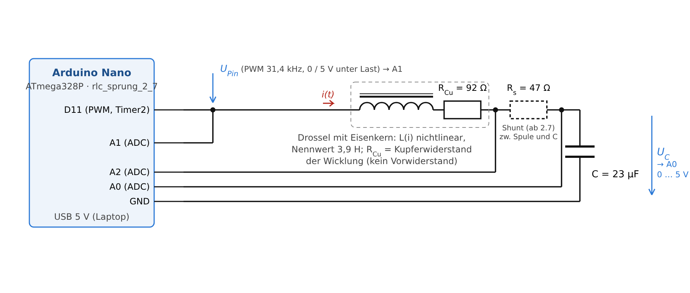

# Nichtlineares RLC-Glied: Sprungantwort mit dem Arduino Nano messen und auswerten

Prof. Dr.-Ing. Ralph Wystup M.Sc. — erstellt mit KI und Agent (Claude Code, Anthropic)

**Seite öffnen:** https://ralphwystup.github.io/Nichtlineares-RLC-Glied-Sprungantwort-mit-Arduino-Nano-messen-und-auswerten/ — eine einzige HTML-Datei: Sprung auslösen und aufzeichnen (Web Serial, Chrome oder Edge),
Sprungantwort und den **Mittelwert der PWM-Anregung** zeichnen, Kennwerte nach dem logarithmischen Dekrement, Messdateien
laden und vergleichen, ein Prüfreiter mit Zoom bis auf den einzelnen Abtastwert, Fotos des Aufbaus, Schaltplan und die
Theorie aus dem Manuskript und von der Theorieseite zum Verfahren_HR (L(i) und C(u) als Kennlinien, tanh-Netze nach dem Verfahren_HR), der über den Messwiderstand gemessene Strom gegen C·dU_C/dt, ein Reiter „Impulsantwort“ (aus der Sprungantwort: ableiten, integrieren, vergleichen, bis der Rest unter einer ADC-Stufe liegt), Strommessung über einen Messwiderstand zwischen Spule und Kondensator (Firmware 2.7, A2). Ohne Nano läuft die Seite mit drei eingebetteten Messungen.

**Zweite Seite – das Verfahren_HR Schritt für Schritt:** [`Verfahren_HR_1.1.html`](Verfahren_HR_1.1.html) (https://ralphwystup.github.io/Nichtlineares-RLC-Glied-Sprungantwort-mit-Arduino-Nano-messen-und-auswerten/Verfahren_HR_1.1.html) führt an der gemessenen Sprungantwort vor, wie aus
Spannungen und Strom die Kennlinien ψ(i) und q(uC) extrahiert werden (RCu aus ψ(∞) = 0, Fluss und Ladung durch Integration,
Eisenverlust RFe aus der Schleife der ψ(i)-Punktwolke), wie beide Kennlinien als tanh-Summen angefittet werden (jede Reihe als Gleichung
mit Koeffiziententafel, gegen ein Polynom gleicher Parameterzahl), wie daraus Ld(i) und Cd(uC) folgen und wie die
nichtlineare DGL damit die Sprungantwort nachbildet (T = 140: 1,7 % der Sprunghöhe) und die zweite Messung ohne Anpassung vorhersagt (T = 128: 3,7 %).
Dazu der direkte Fit der Sprungantwort und die Impulsantwort als Ableitung der Summe, ein Vergleich, wie viele Glieder welcher Weg braucht,
„Simulation und Suche“ (Schritt 11: die Kennlinienparameter und RFe mit Levenberg-Marquardt gegen die Messung nachgestellt, K = 3: 0,28 % ΔU an T = 140,
T = 128 ohne Anpassung 1,3 %; Kennlinien monoton erzwungen, RCu aus ψ(∞) = 0 festgehalten) und „Faltung gegen DGL“ (Schritt 12: die Impulsantwort der
einen Messung als FIR mit der Anregung der anderen gefaltet – gilt nur linear; bei den nahen Anregungen T = 128/140 trifft die Faltung auf 0,5 %, bei
größerem Abstand wandern Scheitel und Periode, was nur die DGL mitführt).

Ein Arduino Nano legt mit Pin 11 (Timer2, 31,4 kHz) einen PWM-Sprung an einen Serienschwingkreis aus einer Drossel
mit Eisenkern (92 Ω ist der Kupferwiderstand ihrer Wicklung) und einem Kondensator. A0 misst die Kondensatorspannung UC, A1 die Pinspannung; beide werden
von Timer1 alle 125 µs abwechselnd gewandelt. Auf A1 werden High- und Low-Treffer getrennt summiert, so dass das
Eingangssignal der Strecke exakt bekannt ist: UE = d·UH + (1 − d)·UL mit den Pegeln
unter Last. Die Nennwerte (92 Ω, 3,9 H, 23 µF) beschreiben die Messung nicht; der Eisenkern macht die Induktivität
vom Strom abhängig, der Überschwingfaktor steigt mit der Anregung (1,54 bei T = 128, 1,63 bei T = 140).

**Schutz des ADC-Eingangs:** Der Tastgrad ist im Nano und in der Seite auf T ≤ 140 begrenzt (Scheitel ≤ 4,5 V, Datenblatt
ATmega328P: 0 … VCC), und nach jeder Messung fährt die Anregung als Rampe auf 0, damit UC nie
negativ wird. Das Datenblatt (Microchip, 7810D–AVR–01/15) liegt nicht bei: https://www.microchip.com/en-us/product/ATmega328P

**Manuskript:** [`rlc_manuskript_2.1_mit_Schaltplan.pdf`](rlc_manuskript_2.1_mit_Schaltplan.pdf) — Vorlesungsmanuskript „Nichtlineare Modellierung der Sprungantwort eines
RLC-Schwingkreises“ (04.03.2026), Fassung 2.1 mit dem Schaltplan, Text unverändert (Abschnitt 3.1 und 8 rechnen dort noch mit einem äußeren Widerstand, den es nicht gibt).

## Was drin ist

| Datei | Inhalt |
|:--|:--|
| [`RLC_Sprung_2.24.html`](RLC_Sprung_2.24.html) | die Seite (All-in-one): Messen über Web Serial, Auswertung, Prüfreiter mit Zoom, Aufbau und Theorie, Stromansicht (Shunt), Reiter „Impulsantwort“, Reiter „Anfitten“ (tanh-Netz nach dem Verfahren_HR gegen Fourier und Potenzreihe bei gleicher Parameterzahl, K steigern bis 0,1 % der Sprunghöhe, Fortsetzungstest) |
| [`Verfahren_HR_1.1.html`](Verfahren_HR_1.1.html) | die zweite Seite (All-in-one): Verfahren_HR in zehn Schritten an den eingebetteten Messungen, eigene rlc27-Dateien ladbar |
| [`rlc_manuskript_2.1_mit_Schaltplan.pdf`](rlc_manuskript_2.1_mit_Schaltplan.pdf) / [`.docx`](rlc_manuskript_2.1_mit_Schaltplan.docx) / [`.md`](rlc_manuskript_2.1_mit_Schaltplan.md) | das Manuskript |
| `nano/` | `rlc_sprung_2_6.ino` (Firmware ohne Shunt) und `rlc_sprung_2_7.ino` (mit A2 = Spulenende, Strom über R_s = 47 Ω zwischen Spule und Kondensator), Befehl `M T N V F B P R`, 1 000 000 Bd; `rlc_bauen_laden_2.6/2.7.py` (arduino-cli, Board `arduino:avr:nano:cpu=atmega328old`), `rlc_messen_2.6/2.7.py` (Messen ohne Browser), `arduino_cli_laden_1.2.py` (arduino-cli portabel holen) |
| `messungen/` | Messdateien 23.11.2026 mit Shunt 47 Ω (rlc27, T = 128 und 140, Spalten … U_C_V U_2_V U_H_V U_L_V U_E_V i_mA), 22.11.2026 ohne Shunt (rlc25/26) und die alte Simulink-Messung vom 03.03.2026 |
| `seite/` | Vorlagen und Erzeuger beider Seiten, Knopfproben (kopfloser Chromium über CDP, Skalierung 1 und 1,5) mit Prüfausgaben, Schaltplan als SVG, `formeln_klammern_1.0.py` (MathML-Klammern), `seite_frage_1.0.mjs` (Nachmessen im Browser) |
| `verfahren_hr/` | Vorrechnung des Kennlinienwegs in Python (NumPy/SciPy): Kennlinien, R_Fe-Abtastung, DGL, Parametersuche (least_squares), Faltungsprüfung |
| `bilder/` | Fotos des Aufbaus, Schaltplan (SVG, PNG) |
| `index.html` | leitet auf die Seite weiter, damit GitHub Pages sie unter der Adresse oben zeigt |
| `RLC_Sprung_2.23.html`, `Verfahren_HR_1.0.html` | Wegweiser früherer Fassungen auf die aktuelle Seite (gemerkte Verweise bleiben gültig) |

## Messen

1. `nano/rlc_sprung_2_6.ino` auf den Nano laden (`python3 nano/rlc_bauen_laden_2.6.py`, arduino-cli vorher mit `arduino_cli_laden_1.2.py` holen; Anschluss im Skript, Vorgabe COM5).
2. `RLC_Sprung_2.24.html` in Chrome oder Edge öffnen, „Verbinden …“, Anschluss wählen, Tastgrad T (0 … 140), „Sprung messen“. Jede Messung wird im gewählten Ordner unter `Messungen_TT.MM.JJJJ` abgelegt.
3. Ohne Browser: `python3 nano/rlc_messen_2.6.py T:N:V:F:B:P[:R]`, z. B. `128:600:3000:3:4:20:2000`.

## Prüfen

    cd seite && node rlc_seite_probe_1.25.mjs <cdp-port> <pfad>/RLC_Sprung_2.24.html <ausgabeordner> 1.5

Die Knopfprobe drückt im kopflosen Chromium jeden Knopf (Reiter, Zoom per Rad und Rahmen, Löschknöpfe zweistufig, Laden,
Kennwerte gegen eigene Rechnung aus der Messdatei, Klammern der Formeln im Bild gemessen): 46 von 46 richtig bei Skalierung 1 und 1,5, Dateiprobe 4 von 4
(`seite/pruefung/`). Nur „Verbinden“ (Web Serial) kann kopflos nicht gedrückt werden.

    cd seite && node verfahren_hr_probe_1.1.mjs <cdp-port> <pfad>/Verfahren_HR_1.1.html <ausgabeordner> 1.5

Die zweite Probe rechnet alle Schritte, prüft die Zahlen gegen die Python-Vorrechnung (R_Cu, R_Fe, C, Fit-Reste, DGL-Fehler an beiden Messungen),
startet die Suche (Schritt 11) und die Faltung (Schritt 12), klickt jeden Schritt an und misst Leinwände, Tafeln, Gleichungen und Klammern:
37 von 37 richtig bei Skalierung 1 und 1,5.

## Lizenz

MIT, siehe [LICENSE](LICENSE).
