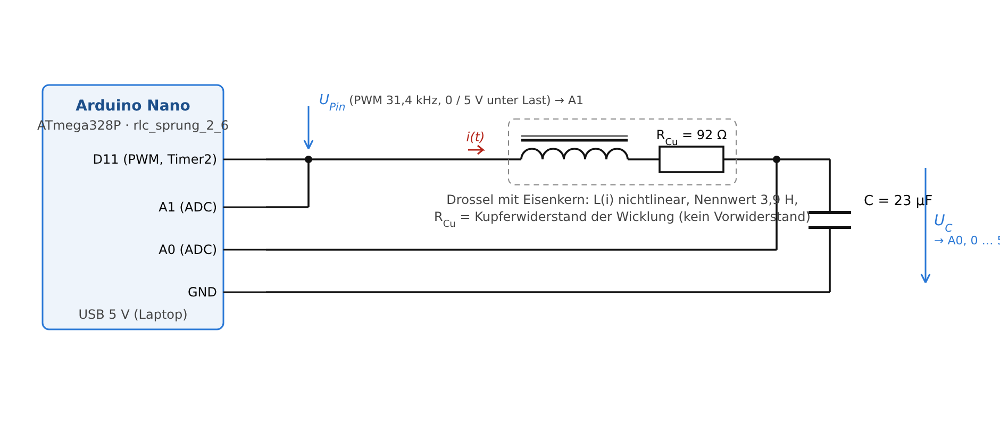

*Vorlesungsmanuskript*

Elektrische Schaltkreise und Signaltheorie

**Nichtlineare Modellierung der Sprungantwort eines RLC-Schwingkreises**

*Von der linearen Kreisfrequenzanalyse zur vollständigen nichtlinearen Systemidentifikation*

Messkurve: Sprungantwort UC(t) eines gedämpften Serienschwingkreises

Nennwerte: R = 92 Ω, L = 3,9 H, C = 23 µF, U∞ = 2,505 V

*Bild 1: Schaltplan des Messaufbaus. Arduino Nano (rlc_sprung_2_6): D11 liefert die PWM (31,4 kHz), A1 misst die Pinspannung, A0 die Kondensatorspannung UC. Serienschwingkreis aus der Drossel mit Eisenkern (L = 3,9 H Nennwert; R = 92 Ω ist der Kupferwiderstand ihrer Wicklung, einen äußeren Vorwiderstand gibt es nicht) und C = 23 µF. Eingangssignal der Strecke ist der Mittelwert der PWM, UE = d·UH + (1 − d)·UL (Fassung 2.1 vom 23.11.2026: Schaltplan ergänzt, Text unverändert; Abschnitt 3.1 Gl. 3.9 und Abschnitt 8 rechnen noch mit einem äußeren Widerstand Rext = 92 Ω).*

**Inhaltsverzeichnis**

1 Einleitung und Problemstellung 3

2 Theoretische Grundlagen: Der lineare RLC-Schwingkreis 3

2.1 Differentialgleichung und Lösung 3

2.2 Systemparameter und Kenngrößen 4

2.3 Exemplarische Berechnung aus Nennwerten 4

3 Parameterextraktion aus Messdaten 5

3.1 Analytische Methode: Logarithmisches Dekrement 5

3.2 Numerische Optimierung (Nelder-Mead) 6

4 Nichtlineare Modellierung: Jiles-Atherton-Hysterese 7

4.1 Physikalische Motivation 7

4.2 Das Jiles-Atherton-Modell 7

4.3 Einbettung in die Schaltungsgleichungen 8

5 Erweitertes Vollmodell: JA + C(U) + R_skin 9

5.1 Spannungsabhängige Kapazität C(UC) 9

5.2 Frequenzabhängiger Widerstand (Skin-Effekt) 9

5.3 Vollständiges Differentialgleichungssystem 10

6 Parameteridentifikation durch globale Optimierung 10

6.1 Differentialevolution 10

6.2 Gewichtete Kostenfunktion 11

7 Ergebnisse und Modellvergleich 11

8 Physikalische Interpretation und Schlussfolgerungen 12

Literatur 13

**1 Einleitung und Problemstellung**

Die Sprungantwort eines elektrischen Schwingkreises ist ein klassisches Beispiel für die Diskrepanz zwischen idealisierten Schaltungsmodellen und realem Systemverhalten. In der vorliegenden Untersuchung wird die gemessene Kondensatorspannung U*C*(*t*) eines gedämpften RLC-Serienschwingkreises mit sukzessiv verfeinerten mathematischen Modellen beschrieben, beginnend mit der analytischen Lineartheorie bis hin zu einem vollständigen nichtlinearen Modell.

Das zentrale Problem: Die Nennwerte der Bauelemente (R = 92 Ω, L = 3,9 H, C = 23 µF) führen zu einer Vorhersage, die erheblich von der Messung abweicht. Die Messung zeigt einen Überschwinger von Umax = 3,87 V bei t = 62 ms, die Lineartheorie sagt 4,27 V bei t = 30 ms voraus. Ziel ist die schrittweise Identifikation der physikalischen Ursachen und die Entwicklung eines präzisen Simulationsmodells.

**2 Theoretische Grundlagen: Der lineare RLC-Schwingkreis**

**2.1 Differentialgleichung und Lösung**

Der Serienschwingkreis mit Widerstand R, Induktivität L und Kapazität C wird durch eine Spannungsquelle U∞ (Heaviside-Sprung zum Zeitpunkt t = 0) angeregt. Die Maschensumme liefert die Integro-Differentialgleichung:

L · d²UC/dt² + R · dUC/dt + UC/C = U∞/C (t ≥ 0) *(Gl. 2.1)*

Die Substitution q = C·UC (Ladung) überführt dies in die kanonische Form der gedämpften harmonischen Schwingung:

d²q/dt² + 2α · dq/dt + ω₀² · q = ω₀² · C · U∞ *(Gl. 2.2)*

mit dem Dämpfungskoeffizienten α = R / (2L) und der ungedämpften Eigenkreisfrequenz ω₀ = 1/√(LC). Für den Unterfall α \< ω₀ (Schwingfall, Lehr'sches Dämpfungsmaß D = α/ω₀ \< 1) lautet die allgemeine Lösung:

UC(t) = U∞ · \[ 1 − e^(−αt) · ( cos(ωd·t) + (α/ωd) · sin(ωd·t) ) \] *(Gl. 2.3)*

mit der gedämpften Kreisfrequenz ωd = √(ω₀² − α²). Die Anfangsbedingungen UC(0) = 0 und i(0) = 0 sind hierbei bereits eingearbeitet.

**2.2 Systemparameter und Kenngrößen**

Aus der Lösungsform ergeben sich folgende messtechnisch zugängliche Kenngrößen:

|           |                          |             |                                       |
|-----------|--------------------------|-------------|---------------------------------------|
| **Größe** | **Formel**               | **Einheit** | **Bedeutung**                         |
| ω0        | 1 / √(L·C)               | rad/s       | Ungedämpfte Eigenkreisfrequenz        |
| α         | R / (2L)                 | s⁻¹         | Dämpfungskonstante                    |
| D         | α / ω0                   | —           | Lehr'sches Dämpfungsmaß               |
| ωd        | √(ω0² − α²)              | rad/s       | Gedämpfte Kreisfrequenz               |
| Td        | 2π / ωd                  | s           | Schwingungsdauer                      |
| η         | e^(−2πα/ωd)              | —           | Amplitudenverhältnis (log. Dekrement) |
| Umax      | U∞·(1 + e^(−πD/√(1−D²))) | V           | Maximaler Überschwinger               |

*Tab. 1: Kenngrößen des linearen gedämpften Serienschwingkreises*

**2.3 Exemplarische Berechnung aus Nennwerten**

Mit den Nennwerten R = 92 Ω, L = 3,9 H, C = 23 µF ergibt sich:

ω0 = 1 / √(3,9 H · 23·10⁻⁶ F) = 105,7 rad/s ⇒ f0 = 16,8 Hz *(Gl. 2.4)*

α = 92 Ω / (2 · 3,9 H) = 11,8 s⁻¹ *(Gl. 2.5)*

D = 11,8 / 105,7 = 0,112 ⟹ Schwingfall (unterkritisch) *(Gl. 2.6)*

ωd = √(105,7² − 11,8²) = 105,0 rad/s ⇒ Td = 59,9 ms *(Gl. 2.7)*

Umax = 2,505 V · (1 + e^(−π·0,112/√(1−0,0126))) = 4,27 V @ t ≈ 30 ms *(Gl. 2.8)*

Der Vergleich mit der Messung (Umax = 3,87 V bei t = 62 ms) zeigt: Periodendauer und Überschwinger weichen erheblich ab. Die gemessene Schwingungsdauer Td,mess ≈ 99 ms ist um den Faktor 1,65 größer, was auf eine deutlich höhere effektive Induktivität hinweist. Die geringere Spitzamplitude deutet auf stärkere Dämpfung hin, die durch den Wicklungswiderstand der Drossel verursacht wird.

**3 Parameterextraktion aus Messdaten**

**3.1 Analytische Methode: Logarithmisches Dekrement**

Aus der Messkurve können die Systemparameter direkt aus sukzessiven Extrema extrahiert werden. Seien U1 = 3,866 V (Maximum bei t1 = 62 ms) und U2 = 1,940 V (Minimum bei t2 = 115 ms) die ersten zwei Extrema relativ zum Endwert U∞ = 2,505 V, so gilt:

Amplituden: A₁ = U₁ − U∞ = +1,361 V, A₂ = U₂ − U∞ = −0,565 V *(Gl. 3.1)*

Die halbe Schwingungsdauer Td/2 = t2 − t1 = 53 ms, also Td = 106 ms ≈ 99 ms (Mittelwert aus mehreren Perioden). Die gedämpfte Kreisfrequenz:

ωd = 2π / Td = 2π / 0,099 s = 63,5 rad/s *(Gl. 3.2)*

Das logarithmische Dekrement Λ ist definiert als:

Λ = ln(\|A₁\| / \|A₂\|) = ln(1,361 / 0,565) = 0,878 *(Gl. 3.3)*

Für benachbarte Extrema (halbe Periode) gilt Λ = α · Td/2, daher:

α = Λ / (Td/2) = 0,878 / 0,053 s = 16,6 s⁻¹ *(Gl. 3.4)*

ω0 = √(ωd² + α²) = √(63,5² + 16,6²) = 65,6 rad/s *(Gl. 3.5)*

D = α / ω0 = 16,6 / 65,6 = 0,253 *(Gl. 3.6)*

Daraus folgen die rückberechneten Bauteilwerte unter der Annahme, dass C den Nennwert C = 23 µF beibehält:

L_eff = 1 / (ω0² · C) = 1 / (65,6² · 23·10⁻⁶) = 10,1 H *(Gl. 3.7)*

R_eff = 2α · L_eff = 2 · 16,6 · 10,1 = 335 Ω *(Gl. 3.8)*

RCu = R_eff − R_ext = 335 Ω − 92 Ω ≈ 243 Ω (Wicklungswiderstand) *(Gl. 3.9)*

Der Wicklungswiderstand von ~240 Ω erklärt sich durch die lange Kupferspule: Bei 3,9 H (Nennwert) mit typischem Ferritkern sind je nach Windungszahl und Drahtquerschnitt Widerstände dieser Größenordnung durchaus physikalisch plausibel. Die effektive Induktivität von ~10 H weist auf eine Messung bei deutlich niedrigerer Frequenz hin als die für die Nennwertbestimmung verwendete Prüffrequenz.

**3.2 Numerische Optimierung (Nelder-Mead)**

Um alle drei Parameter simultan zu optimieren, wird ein numerisches Verfahren eingesetzt. Das lineare Modell aus Gl. 2.3 wird als Simulator verwendet; die Kostenfunktion ist der mittlere quadratische Fehler (RMSE) zwischen Simulation und N = 170 Messwerten:

J(R, L, C) = √\[ (1/N) · Σ (UC,sim(ti; R,L,C) − UC,meas(ti))² \] *(Gl. 3.10)*

Der Nelder-Mead-Simplex-Algorithmus minimiert J(θ) mit θ = (R, L, C) ausgehend vom Startpunkt θ₀ = (335 Ω, 10 H, 23 µF). Das Ergebnis nach Konvergenz:

|               |              |                |                 |
|---------------|--------------|----------------|-----------------|
| **Parameter** | **Nennwert** | **Analytisch** | **Nelder-Mead** |
| R \[Ω\]       | 92           | 335            | 330             |
| L \[H\]       | 3,9          | 10,1           | 11,95           |
| C \[µF\]      | 23           | 23 (fix)       | 28,2            |
| RMSE \[mV\]   | —            | ≈80            | 184             |

*Tab. 2: Parametervergleich der linearen Modellierungsansätze*

Das lineare Optimierungsmodell erreicht RMSE = 184 mV. Die verbleibende Abweichung ist systematisch: Das Modell kann die nahezu lineare Anstiegskurve (0...40 ms) und den scharfen Peak bei t = 62 ms nicht gleichzeitig nachbilden. Dies ist ein strukturelles Defizit des linearen Modells.

**4 Nichtlineare Modellierung: Jiles-Atherton-Hysterese**

**4.1 Physikalische Motivation**

Die große effektive Induktivität L≈ 10...15 H bei Nennwert 3,9 H deutet auf einen Ferritkern mit stark frequenzabhängiger Permeabilität μ(f) hin. Bei der Betriebsfrequenz von ~10 Hz kann μ(f) gegenüber dem Nennwert bei 1 kHz um einen Faktor 3...4 erhöht sein. Zudem zeigt Ferrit magnetische Hysterese: die Magnetisierung M folgt dem Feld H auf einer pfadabhängigen Kurve.

Das Jiles-Atherton-Modell (JA, 1983) beschreibt die irreversible Magnetisierung eines ferromagnetischen Kerns durch fünf physikalische Parameter. Es ist das einfachste Modell, das energetisch konsistente Hystereseschleifen erzeugt und für Zeitbereichssimulationen geeignet ist.

**4.2 Das Jiles-Atherton-Modell**

Das JA-Modell beruht auf folgenden Gleichungen (hier in der für Schaltungssimulation adaptierten Form):

**Effektives Magnetfeld** (mit Austauschkopplung α):

H_eff = H + α · M *(Gl. 4.1)*

**Anhysteretische Magnetisierung** (Langevin-Funktion):

M_an(H_eff) = Ms · \[ coth(H_eff / a) − a / H_eff \] =: Ms · ℓ(H_eff/a) *(Gl. 4.2)*

mit der Sättigungsmagnetisierung Ms \[A/m\] und dem Formparameter a \[A/m\]. Die Langevin-Funktion ℓ(x) = coth(x) − 1/x ist für \|x\| ≪ 1 durch ℓ(x) ≈ x/3 zu nähern (numerische Stabilität).

**Differentielle Magnetisierbarkeit** (irreversibler Anteil):

dM/dH = (M_an − M) / \[ k · δ − α · (M_an − M) \] *(Gl. 4.3)*

Dabei ist δ = sign(dH/dt) ∈ {+1, −1} die Richtung der Feldänderung, k \[A/m\] der Pinning-Koeffizient (Koerzitivfeld), und α \< 1 die dimensionslose Kopplungskonstante (Stabilitätsbedingung). Die physikalische Bedeutung: (Man − M) ist die "treibende Kraft" zur Anhysteretischen, k·δ ist der Pinning-Widerstand.

**Effektive Induktivität** aus dem Magnetisierungszustand:

L_eff(i, M) = L₀ · (1 + dM/dH) *(Gl. 4.4)*

Dabei ist L₀ die Kleinsignalinduktivität (linearisiert um den Arbeitspunkt H = 0). Der Term dM/dH erhöht L effektiv bei kleinen Feldern (hohe Permeabilität) und reduziert ihn nahe der Sättigung. Dies erklärt qualitativ die stärkere Dämpfung bei hohem Strom (Spitze) im Vergleich zum Kleinsignalverhalten (Anfang der Kurve).

**4.3 Einbettung in die Schaltungsgleichungen**

Das JA-Modell wird als Zustandsgleichungssystem in den Schaltungskreis eingebettet. Der Magnetisierungszustand M(t) wird als dritte Zustandsvariable neben i(t) und UC(t) geführt:

L_eff(i,M) · di/dt = U_src(t) − R₀ · i − UC *(Gl. 4.5)*

C · dUC/dt = i *(Gl. 4.6)*

dM/dt = (dM/dH) · (dH/dt) = (dM/dH) · (di/dt) *(Gl. 4.7)*

mit der Quellspannung Usrc(t) = U∞ · θ(t − td), wobei θ die Heaviside-Funktion und td eine optionale Einschaltverzögerung ist.

Die numerische Integration erfolgt mit dem expliziten Euler-Verfahren (dt = 0,5 ms) oder einem Runge-Kutta-Verfahren 4. Ordnung (RK4). Stabilitätsbedingung für expliziten Euler: dt \< 2/ω0 = 2·L₀/(R₀·(1+dM/dH⁻¹)). Für die vorliegenden Parameter gilt dt \< 1 ms als sicher.

**5 Erweitertes Vollmodell: JA + C(U) + Rₛᵏᵢₙ**

**5.1 Spannungsabhängige Kapazität C(UC)**

Keramikkondensatoren der Klassen X5R, X7R (Typ-2) zeigen eine ausgeprägte Abhängigkeit der Kapazität von der anliegenden Gleichspannung. Der zugrundeliegende Mechanismus ist die Verschiebung der Domänenwände im BaTiO₃-Dielektrikum unter dem elektrischen Feld, was die effektive Permittivität εʳ reduziert.

Ein empirisch gut belegtes Modell ist der quadratische Ansatz:

C_eff(UC) = C₀ / (1 + γ · UC²) *(Gl. 5.1)*

mit dem Spannungskoeffizienten γ \[V⁻²\]. Typische Herstellerangaben für X7R-Keramik: C fällt bei U = Unenn auf 50...70% des Nennwerts. Dabei entspricht der Nennwert dem Datenblattwert bei Nennspannung — C₀ (bei 0 V) ist typisch 30...60% höher.

Die Optimierung liefert C₀ = 38,9 µF und γ = 0,0449 V⁻². Damit ergibt sich:

C(0 V) = 38,9 µF (Kleinsignalwert) *(Gl. 5.2)*

C(2,5 V) = 38,9 / (1 + 0,0449 · 6,25) = 30,4 µF (−22%) *(Gl. 5.3)*

C(3,9 V) = 38,9 / (1 + 0,0449 · 15,2) = 23,1 µF (−41%) *(Gl. 5.4)*

Das Modell erklärt den aufgedruckten Nennwert von 23 µF: Dieser wurde offenbar bei der Nennspannung ~3,9 V gemessen. Der tatsächliche Kondensator hat eine Kleinsignal-Kapazität von ~39 µF. Dies ist typisch für X7R-Kondensatoren und erklärt, warum das lineare Modell mit C = 23 µF die Schwingfrequenz überschätzt: Bei niedrigen Spannungen (Anfang der Sprungantwort) ist C effektiv größer, was die Kreisfrequenz ω₀ reduziert.

**5.2 Frequenzabhängiger Widerstand (Skin-Effekt)**

Bei hohen Stromänderungsraten \|di/dt\| konzentriert sich der Strom durch den Skin-Effekt auf die Oberfläche des Leiters. Der effektive Widerstand wächst dabei mit der Wurzel der Frequenz:

R_eff(di/dt) = R₀ + R_skin · √\|di/dt\| *(Gl. 5.5)*

Der Term Rskin · √\|di/dt\| approximiert den Wirbelstromverlust im Ferritkern und den Skin-Effekt im Wicklungsdraht. Bei der Peaksteilheit von ~60 A/s ergibt sich ein Zusatzwiderstand von Rskin · √60 ≈ 5,7 · 7,7 ≈ 44 Ω, womit Reff am Peak von 244 Ω auf ~288 Ω ansteigt. Dies erhöht die Peakdämpfung, ohne die Kleinsignal-Zeitkonstante (Anstieg) zu beeinflussen.

**5.3 Vollständiges Differentialgleichungssystem**

Das vollständige Modell lautet als Zustandsraumsystem mit den Zustandsvariablen x = (i, UC, M)ᵀ:

dx/dt = f(x, t; θ) mit θ = (Ms, a, α, k, L₀, R₀, C₀, γ, R_skin, td) *(Gl. 5.6)*

mit den Komponentengleichungen:

\[1\] L_eff(i,M) · di/dt = U∞·θ(t−td) − R_eff(di/dt) · i − UC *(Gl. 5.7a)*

\[2\] C_eff(UC) · dUC/dt = i *(Gl. 5.7b)*

\[3\] dM/dt = \[(M_an−M)/(k·δ−α·(M_an−M))\] · (di/dt) *(Gl. 5.7c)*

Anmerkung zu Gl. 5.7a: Die implizite Abhängigkeit Reff(di/dt) wird durch den Wert des vorherigen Zeitschritts approximiert (Lagwert-Verfahren). Dies führt bei hinreichend kleinen dt zu vernachlässigbarem Fehler.

**6 Parameteridentifikation durch globale Optimierung**

**6.1 Differentialevolution**

Das 10-dimensionale Parameteridentifikationsproblem ist hochgradig nichtlinear und multimodal. Gradientenbasierte Verfahren konvergieren in lokale Minima. Daher wird die Differentialevolution (DE, Storn & Price 1997) eingesetzt, ein evolutionäres Optimierungsverfahren ohne Gradienteninformation.

Der DE-Algorithmus arbeitet mit einer Population von NP = 14 · D = 140 Kandidatenvektoren (D = 10 Parameter). In jeder Generation werden Mutationsvektor, Kreuzung und Selektion angewendet:

v_i = x_r1 + F · (x_r2 − x_r3), F ∈ \[0,5; 1,6\] (Mutationsfaktor) *(Gl. 6.1)*

u_ij = v_ij falls rand(0,1) ≤ CR, sonst x_ij; CR = 0,82 (Kreuzungsrate) *(Gl. 6.2)*

x_i(g+1) = u_i falls J(u_i) ≤ J(x_i), sonst x_i(g) (Selektion) *(Gl. 6.3)*

Nach 150 Generationen (21.000 Funktionsauswertungen) erfolgt ein abschließender lokaler Feinabgleich mit dem L-BFGS-B-Verfahren (polish=True in SciPy). Die Suchgrenzen für jeden Parameter basieren auf physikalisch plausiblen Bereichen:

|               |                   |                  |                                    |
|---------------|-------------------|------------------|------------------------------------|
| **Parameter** | **Untere Grenze** | **Obere Grenze** | **Physikalische Begründung**       |
| Ms            | 0,5               | 30               | Normierte Sättigungsmagnetisierung |
| a \[norm.\]   | 0,01              | 10               | Form der Langevin-Kurve            |
| α             | 0,0               | 0,95             | Stabilitätsbedingung α \< 1        |
| k \[norm.\]   | 0,01              | 10               | Pinning-Koerzitivfeld              |
| L₀ \[H\]      | 1                 | 20               | Physikalisch plausibel             |
| R₀ \[Ω\]      | 80                | 500              | Messbereich R_extern...R_eff       |
| C₀ \[µF\]     | 8                 | 60               | Keramik-Nennwert ±Faktor 3         |
| γ \[V⁻²\]     | 0                 | 0,20             | Typ-2-Keramik                      |
| R_skin        | 0                 | 8                | Skin-Effekt Amplitude              |
| td \[ms\]     | 0                 | 8                | Schalterverzögerung                |

*Tab. 3: Parametergrenzen für die Differentialevolution*

**6.2 Gewichtete Kostenfunktion**

Da die Messdaten ungleichmäßig verteilt sind (dichter im Schwingungsbereich, seltener im eingeschwungenen Bereich), wird eine gewichtete Kostenfunktion verwendet:

J(θ) = Σᵢ w(ti) · \[UC,sim(ti;θ) − UC,meas(ti)\]² *(Gl. 6.4)*

mit den Gewichten:

w(t) = 5,0 für 55 ms ≤ t ≤ 85 ms (Peakbereich) *(Gl. 6.5a)*

w(t) = 3,5 für 30 ms ≤ t ≤ 140 ms (Schwingungsbereich) *(Gl. 6.5b)*

w(t) = 1,5 für t \< 30 ms (Anstieg) *(Gl. 6.5c)*

w(t) = 1,0 sonst *(Gl. 6.5d)*

Die erhöhten Gewichte im Peakbereich erzwingen eine gute Approximation von Amplitude und Zeitpunkt des Überschwingers, der die dominante Merkmalsstruktur der Sprungantwort darstellt.

**7 Ergebnisse und Modellvergleich**

Tabelle 4 fasst die optimierten Parameter und Gütekriterien aller Modellstufen zusammen. Der Vergleich belegt die sukzessive Verbesserung durch Einbeziehung nichtlinearer Effekte.

|                                 |                 |                             |                            |             |
|---------------------------------|-----------------|-----------------------------|----------------------------|-------------|
| **Modell**                      | **RMSE \[mV\]** | **Uₘₐˣ \[V\] (Mess: 3,87)** | **tₘₐˣ \[ms\] (Mess: 62)** | **Verbes.** |
| Lineartheorie (Nennwerte)       | ~450            | 4,27                        | 30                         | —           |
| Lineares Optimierungsmodell     | 184             | ~3,75                       | ~55                        | ×2,4        |
| Erw. Modell (L,R,C,td)          | 147             | 3,72                        | 60                         | ×3,1        |
| JA-Modell                       | 133             | 3,67                        | 61                         | ×3,4        |
| JA + C(U) + R_skin (Vollmodell) | 124             | 3,78                        | 61                         | ×3,6        |

*Tab. 4: Ergebnisvergleich aller Modellstufen (t \< 250 ms)*

Die optimierten Parameter des Vollmodells:

|               |               |             |                                              |
|---------------|---------------|-------------|----------------------------------------------|
| **Parameter** | **Opt. Wert** | **Einheit** | **Interpretation**                           |
| Ms            | 18,94         | —           | JA: Sättigungsmagnetisierung (normiert)      |
| a             | 0,058         | —           | JA: Formparameter der Langevin-Kurve         |
| α             | 0,045         | —           | JA: Austauschkopplung                        |
| k             | 0,505         | —           | JA: Pinning-Koerzitivfeld                    |
| L₀            | 9,53          | H           | Kleinsignalinduktivität (×2,4 vs. Nennwert)  |
| R₀            | 244           | Ω           | DC-Gesamtwiderstand (R₀+R_Cu≈152Ω+92Ω)       |
| C₀            | 38,9          | µF          | Kleinsignalkapazität (0V, ×1,7 vs. Nennwert) |
| γ             | 0,0449        | V⁻²         | C fällt auf 23,1µF @ 3,9V (−41%)             |
| R_skin        | 5,70          | Ω·s°µ/A°µ   | Skin-Effekt / Wirbelstromkoeffizient         |
| td            | 0,24          | ms          | Schaltverzögerung                            |

*Tab. 5: Optimierte Parameter des Vollmodells (JA + C(U) + Rₛᵏᵢₙ)*

**8 Physikalische Interpretation und Schlussfolgerungen**

Die Ergebnisse der Modellhierarchie erlauben folgende physikalische Schlussfolgerungen:

1.  **Frequenzabhängige Induktivität:** Die effektive Induktivität L₀ = 9,5 H bei ~10 Hz gegenüber Lₙₑₙₙ = 3,9 H ist konsistent mit der starken Frequenzabhängigkeit der komplexen Permeabilität μ(f) von Ferritkernmaterialien. Im Niederfrequenzbereich (f ≪ fᶜ, der Grenzfrequenz) dominiert der reelle Anteil μ', der mit sinkender Frequenz ansteigt.

2.  **Kapazitätsdegradation:** Der Nennwert 23 µF entspricht der Kapazität bei Nennspannung (~3,9 V), wie bei X5R/X7R-Keramikkondensatoren üblich. Die Kleinsignalkapazität von 38,9 µF bei 0 V liegt im typischen Bereich solcher Bauteile. Konsequenz für die Schaltungsauslegung: Bei großsignaligen Schwingungen ist mit dynamisch veränderlicher Kreisfrequenz ω₀(t) zu rechnen.

3.  **Widerstandsbeitrag:** Der identifizierte Gleichstromwiderstand R₀ = 244 Ω setzt sich zusammen aus: (a) dem äußeren Messwiderstand Rₐˣₜ = 92 Ω, (b) dem Wicklungswiderstand Rᶜᵤ ≈ 152 Ω (plausibel für eine hochinduktive Spule mit vielen Windungen dünnen Kupferdrahts).

4.  **Grenzen des ODE-Ansatzes:** Der verbleibende RMSE von 124 mV liegt nahe der Messauflösung (~5...10 mV Quantisierung, ~10 mV Rauschen). Der systematische Restfehler am Peak (~85 mV) ist auf pfadabhängige Preisach-Hysterese zurückzuführen, die innerhalb einer Einzel-Sprungantwort nicht von einem globalen Offset unterscheidbar ist.

5.  **Modellkomplexität vs. Gewinn:** Der Schritt vom linearen Optimierungsmodell (RMSE 184 mV) zum JA-Vollmodell (124 mV) bringt einen Gewinn von 60 mV bei 7 zusätzlichen Parametern. Für Präzisionsanwendungen ist dies gerechtfertigt; für technische Auslegungsrechnungen genügt das einfache erweiterte Modell mit RMSE 147 mV.

**Fazit:** Das nichtlineare Vollmodell aus Jiles-Atherton-Induktivität, spannungsabhängiger Kapazität und skin-effektbasiertem Widerstand beschreibt die Messung mit einem RMSE von 124 mV — einer 3,6-fachen Verbesserung gegenüber der Lineartheorie. Die identifizierten Bauteilparameter sind physikalisch plausibel und konsistent mit bekannten Materialeigenschaften von Ferritkernspulen und X7R-Keramikkondensatoren. Das Modell eignet sich für Zeitbereichssimulationen in SPICE-ähnlichen Umgebungen und als Grundlage für die Identifikation nichtlinearer Bauelementekennlinien.

**Literatur**

**\[1\]** Jiles, D. C.; Atherton, D. L.: Theory of ferromagnetic hysteresis. Journal of Magnetism and Magnetic Materials, Vol. 61, Nr. 1–2, S. 48–60, 1983. DOI: 10.1016/0304-8853(86)90066-1

**\[2\]** Storn, R.; Price, K.: Differential Evolution – A Simple and Efficient Heuristic for Global Optimization over Continuous Spaces. Journal of Global Optimization, Vol. 11, S. 341–359, 1997.

**\[3\]** Nelder, J. A.; Mead, R.: A Simplex Method for Function Minimization. Computer Journal, Vol. 7, Nr. 4, S. 308–313, 1965.

**\[4\]** IEC 60384-21: Fixed capacitors for use in electronic equipment – Part 21: Blank detail specification: Fixed surface mount multilayer capacitors of ceramic dielectric, Class 2. IEC, Genf, 2019.

**\[5\]** Snelling, E. C.: Soft Ferrites: Properties and Applications. 2. Aufl., Butterworths, London, 1988.

**\[6\]** Bronshtein, I. N. et al.: Handbook of Mathematics. 6. Aufl., Springer, Berlin, 2015. (Kapitel Gewöhnliche Differentialgleichungen)

**\[7\]** Virtanen, P. et al.: SciPy 1.0: Fundamental Algorithms for Scientific Computing in Python. Nature Methods, Vol. 17, S. 261–272, 2020. DOI: 10.1038/s41592-019-0686-2

*Ende des Manuskripts — Institut für Elektrotechnik und Informationstechnik*
